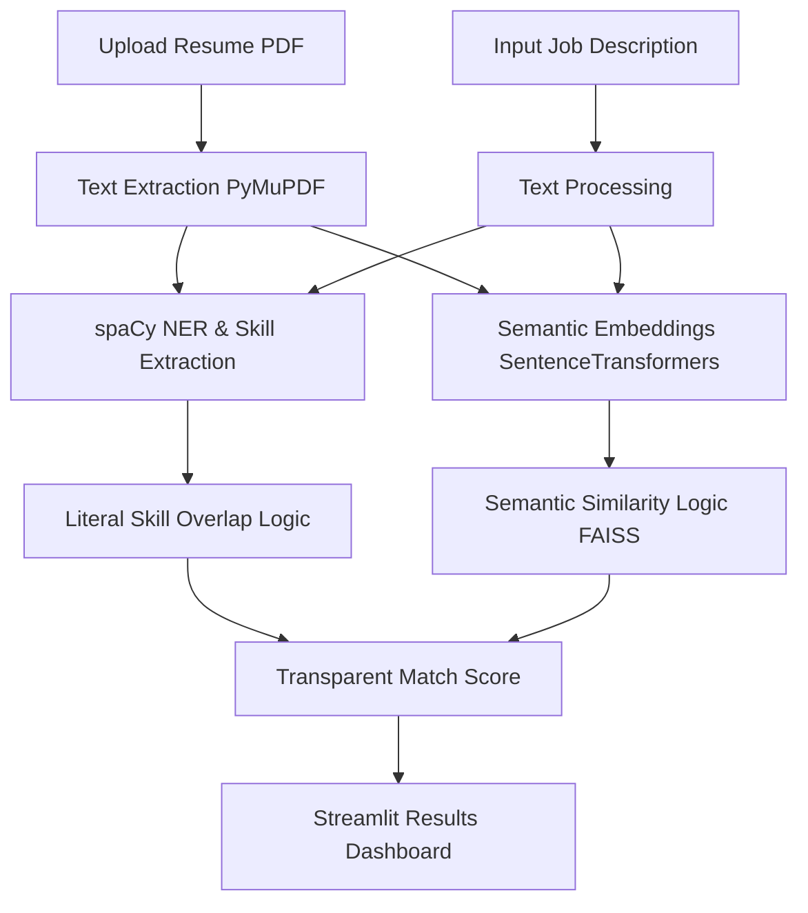

# AI-Powered Resume & Job Matching System

## 📖 What is the Project About?
An AI-driven NLP application designed to evaluate resumes against Job Descriptions (JDs). It goes beyond simple keyword matching by using contextual semantic search to compute a transparent, explainable "Match Score," helping to highlight why a candidate is a good fit.

## 🎯 Importance of the Project
Modern Applicant Tracking Systems (ATS) often rely on rigid keyword filters that penalize highly qualified candidates who simply use different terminology. Conversely, pure LLM "black-box" evaluations can introduce unchecked biases. This project balances both by providing an *explainable* score—clearly highlighting matched skills, missing skills, and semantic relevance, ensuring fair candidate evaluation.

## 👥 Who is this for?
- **Recruiters & HR Teams:** To accelerate the candidate screening process fairly and transparently.
- **Job Seekers:** To optimize their resumes against target job descriptions.
- **AI/NLP Engineers:** Building hybrid semantic/keyword search pipelines.

## 🏗️ Architecture


## 💻 Tech Stack
- **Core:** Python 3.11+
- **NLP & Embeddings:** spaCy (`en_core_web_sm`), SentenceTransformers (`all-MiniLM-L6-v2`)
- **Vector Search:** FAISS
- **Document Parsing:** PyMuPDF
- **Backend API:** FastAPI
- **Frontend UI:** Streamlit

## 🚀 Steps to Clone & Setup

1. **Clone the repository:**
   ```bash
   git clone https://github.com/vamshidharsingh/resume-job-matching-system.git
   cd resume-job-matching-system
   ```
2. **Create and activate a virtual environment:**
   ```bash
   python -m venv venv
   
   # On macOS/Linux:
   source venv/bin/activate  
   
   # On Windows:
   .\venv\Scripts\activate
   ```
3. **Install dependencies:**
   ```bash
   pip install -r requirements.txt
   
   # Download the required spaCy model
   python -m spacy download en_core_web_sm
   ```

## 🕹️ How to Use It
1. **Start the API:** Launch the matching engine backend.
   ```bash
   python api.py
   # Or: uvicorn api:app --port 8004
   ```
2. **Start the UI:** In a new terminal, launch the Streamlit frontend.
   ```bash
   streamlit run app.py --server.port 8504
   ```
3. **Interact:** Open `http://localhost:8504`. Upload a sample resume (PDF), paste a job description into the text area, and click "Match" to see the explainable breakdown of the candidate's fit!

## 🔮 Possible Improvements / Future Enhancements
- **Domain-Specific Fine-Tuning:** Training the embedding model specifically on technical/engineering vocabularies to better understand nuanced tech stacks.
- **LLM Synthesis:** Adding an optional generative layer where an LLM writes a concise 2-sentence summary of *why* the candidate is a fit.
- **Batch Processing:** Allowing recruiters to upload a zip file of 50 resumes and bulk-rank them simultaneously.

## 📄 License
This project is licensed under the MIT License.
